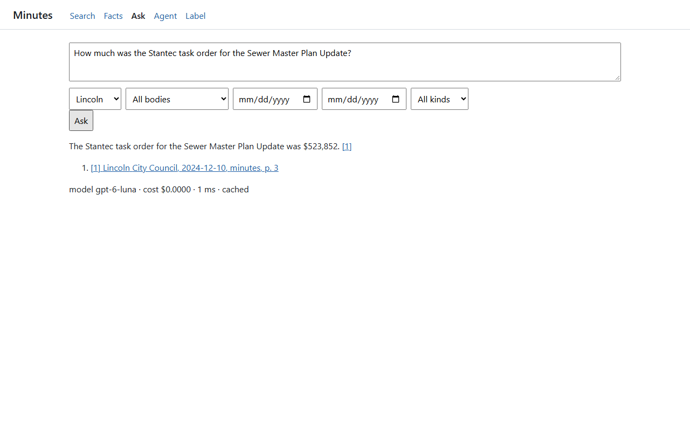
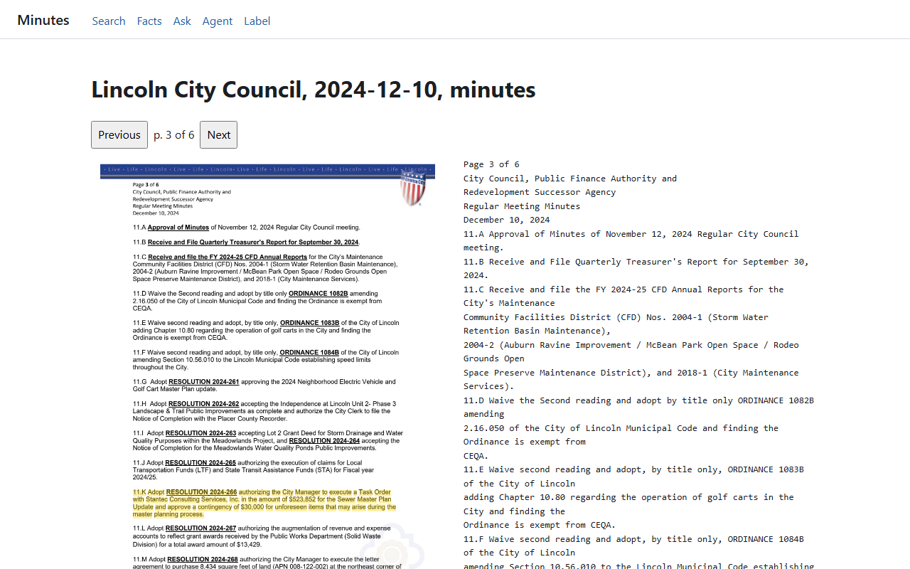
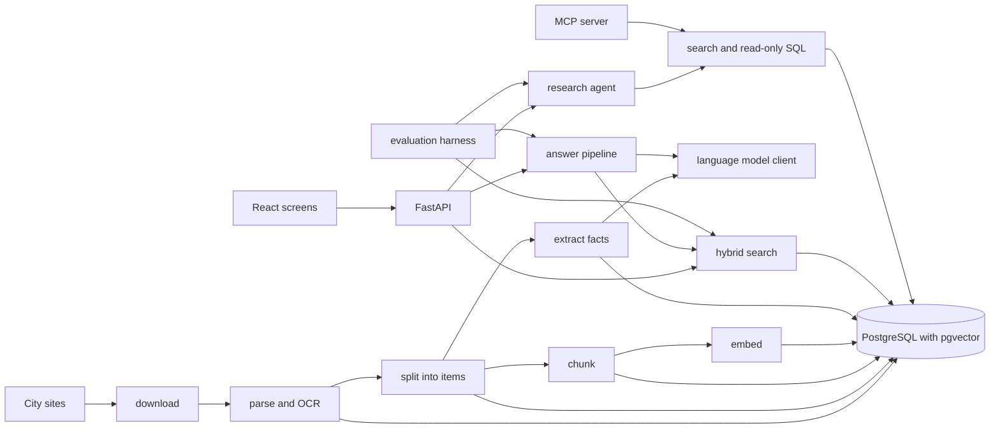
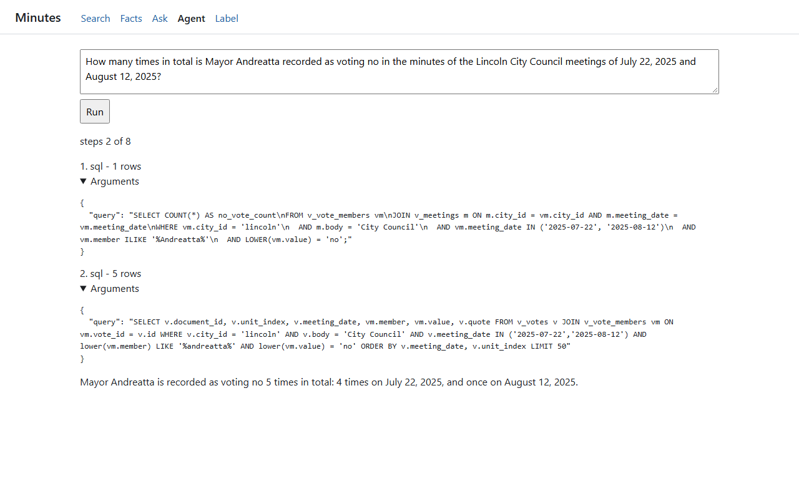

# Minutes

Minutes collects city council agendas, minutes, and meeting captions for Seattle, WA and Lincoln, CA, pulls out votes, ordinances, and dollar amounts, and answers questions with citations that open the exact passage on the source page.



## How it works

A worker runs every document through a queue of stages: download, parse, OCR for scanned pages, split into agenda items, chunk, embed, and extract facts. Each page becomes a unit of text with word boxes, so any span of text can be drawn back onto the page image. Extraction asks a language model for votes, ordinances, amounts, motions, and statements per item, then checks each record against the item text and keeps the quote offsets. Records that fail the check are stored but marked unverified.

Search combines Postgres full-text search and pgvector similarity by rank fusion and reranks the top 50 with a cross-encoder. The answer pipeline writes an answer from the top hits with numbered citations, checks each cited sentence against its passage, and declines when the records don't support an answer. Answers are cached by question, filters, and corpus version. A research agent can use the same search plus a read-only SQL tool over a set of views, with limits on steps, cost, time, and rows, and the same two tools are served over MCP.







More detail, including the table list, is in [docs/architecture.md](docs/architecture.md).

## Running it

You need Docker, [uv](https://docs.astral.sh/uv/), and Node 22. The default setup runs on a small fixture corpus with deterministic stand-ins for every model, so it needs no GPU and no API key.

```
cp .env.example .env
uv run python tasks.py setup
uv run python tasks.py check
uv run python tasks.py demo --smoke
```

`uv run python tasks.py demo` starts the app on http://127.0.0.1:8000 and keeps it running.

To use a real model, point `MINUTES_LLM_BASE_URL` and `MINUTES_LLM_API_KEY` in `.env` at any OpenAI-compatible endpoint and set `MINUTES_LLM_MODE=live`. The real corpus also needs a GPU with 12 GB for embeddings, reranking, and OCR: set `MINUTES_MODELS_MODE=gpu` and `MINUTES_CORPUS=full`, run `uv run python tasks.py setup --gpu`, then `uv run minutes ingest discover` and `uv run minutes ingest run --stages download,parse,ocr,segment,chunk,embed,extract`.

## Results

The numbers come from 320 labelled cases: 60 questions (48 answerable, 12 not), 20 agenda item counts, 220 extraction cases, and 20 multi-step agent tasks, each pinned to a passage of a source page. Each label records its author. 320 of the 320 labels were written by an automated labelling pass that read source pages only, before any retrieval or extraction ran on the corpus, and 0 were written by me; 0 of 320 have been reviewed by a human. Metrics that depend on a language model are the median of 5 runs. The baseline answer pipeline was measured first with `gpt-6.1-sol` for writing and grading; every other model-dependent number, including the final pipeline, used `gpt-6-luna`, so the baseline and final rows also differ in model. Costs are list-price equivalents computed from token counts; nothing was billed. `uv run python tasks.py eval --full` reruns everything and rewrites this table, and a smaller recorded suite gates every change in CI by replaying recorded model responses.

<!-- results:start -->

| Metric | Value | Runs (min / median / max) | Dataset |
| --- | ---: | --- | --- |
| documents | 854 | n/a | full |
| pages | 5966 | n/a | full |
| cities | 2 | n/a | full |
| recall@10 keyword | 0.4167 | n/a | full |
| recall@10 vector | 0.7708 | n/a | full |
| recall@10 hybrid | 0.7708 | n/a | full |
| recall@10 hybrid + reranker | 0.8542 | n/a | full |
| recall@5 hybrid + reranker | 0.8333 | n/a | full |
| recall@20 hybrid + reranker | 0.8958 | n/a | full |
| recall@10 fixed-size chunks, vector | 0.4167 | n/a | full |
| agenda segmentation exact count | 1 | n/a | full |
| agenda segmentation mean absolute error | 0 | n/a | full |
| extraction accuracy | 0.8364 | 5 (0.8273 / 0.8364 / 0.8455) | full |
| answer accuracy baseline | 0.4375 | 5 (0.4375 / 0.4375 / 0.4375) | full |
| answer accuracy final | 0.7708 | 5 (0.7708 / 0.7708 / 0.7917) | full |
| answer accuracy LangGraph | 0.7708 | 5 (0.7708 / 0.7708 / 0.7917) | full |
| faithfulness baseline | 0.9286 | 5 (0.9286 / 0.9286 / 0.9643) | full |
| faithfulness final | 0.9762 | 5 (0.9756 / 0.9762 / 1) | full |
| decline accuracy final | 1 | 5 (1 / 1 / 1) | full |
| agent task completion | 0.45 | 5 (0.3 / 0.45 / 0.5) | full |
| cost per query, controls off | 0.000471 | n/a | full |
| cost per query, controls on | 0.000292 | n/a | full |
| cost reduction | 0.380042 | n/a | full |
| answer latency p50 | 4390 | n/a | full |
| answer latency p95 | 6911 | n/a | full |
| parse quality lincoln | 0.9309 | n/a | lincoln |
| parse quality seattle | 0.978 | n/a | seattle |
| pgvector ANN recall@10 | 0.8183 | n/a | full |
| pgvector ANN p50 | 11.9326 | n/a | full |
| pgvector ANN p95 | 18.8187 | n/a | full |
| Qdrant ANN recall@10 | 0.845 | n/a | full |
| Qdrant ANN p50 | 14.5465 | n/a | full |
| Qdrant ANN p95 | 33.7882 | n/a | full |
| answer grader agreement | 1 | n/a | full |
| support grader agreement | 1 | n/a | full |
| labels written by an automated pass | 320 of 320 | n/a | full |
| labels written by a human | 0 of 320 | n/a | full |
| labels reviewed by a human | 0 of 320 | n/a | full |

<!-- results:end -->

## Limitations

- It covers 2 cities, and the question set has only 48 answerable questions, so one question moves answer accuracy by about 2 points.
- The labels have not been checked by a person, and answer correctness and faithfulness are scored by a language model. The grader matched the labels on its validation set (agreement 1.0), but that check ran on `gpt-6.1-sol`, and the final numbers were graded by `gpt-6-luna`.
- The agent completes 45 percent of the 20 tasks against a 70 percent target. Every run that failed hit the 120-second time limit, because single model calls through my endpoint took between 2 and 351 seconds.
- Extraction accuracy is 0.8364, below my 0.85 target. Statements are the weakest kind at 0.725: the model misses people who present, introduce, or announce an item.
- Lincoln minutes before December 2024 and all Planning Commission minutes list votes as `Name – Aye` lines, which the vote check does not read, so votes from those documents are rejected.
- There is no speech-to-text. Transcripts are the captions the cities publish: every Lincoln caption has the speaker `COUNCIL`, and Seattle captions name no speaker.
- Model routing picks between two models, but both were set to the same model here, so the 38 percent cost reduction comes from the response cache alone.

## What I'd do next

- Run the agent against a faster model endpoint to see how much of the time-limit failure goes away without code changes.
- Read the `Name – Aye` vote format so older Lincoln minutes and Planning Commission votes count.
- Add speech-to-text for meetings whose captions are missing or poor.
- Have a person review the 320 labels and report agreement with the automated pass.
