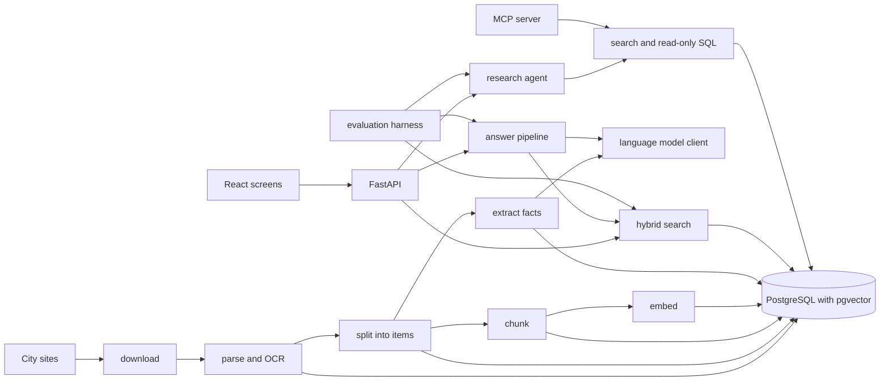

# Architecture

A worker takes jobs from a queue table and runs each document through a fixed list of stages. `download` fetches agendas, minutes, and caption files from the city sites. `parse` turns each PDF page into a unit of text with word boxes, and `ocr` reads the pages that have no text layer. Caption files become units too, one per timed segment. `segment` splits agendas and minutes into numbered items, `chunk` cuts items into chunks with the item heading attached, and `embed` stores a vector for each chunk. `extract` asks a language model for votes, ordinances, amounts, motions, and statements per item, then checks each record against the item text and keeps the quote offsets, so every fact points back to a span on a page.

A question goes through hybrid search first: keyword and vector results are merged by rank fusion and the top 50 are reranked by a cross-encoder. The answer pipeline writes an answer from the top hits with numbered citations, checks that each cited sentence is supported by its passage, and declines when nothing relevant was found or the check fails. Answers are cached by question, filters, and corpus version. The research agent can call the same search and a read-only SQL tool over a set of views, with limits on steps, cost, time, and rows. The same two tools are served over MCP.

Tables:

- `cities`, `meetings`, `documents`: what was found on each city site and where the files are.
- `units`: page or caption text, with word boxes for pages.
- `items`: agenda and minutes items with their offsets into the units.
- `chunks`: searchable text with a full-text index and a vector index.
- `facts`: extracted records with their quote offsets and whether they passed the check.
- `jobs`, `stage_runs`: the work queue and which stage version produced each output.
- `labels`: the evaluation cases, each pinned to a passage by offset.
- `llm_calls`, `answer_cache`: every model call with its tokens and cost, and cached answers.
